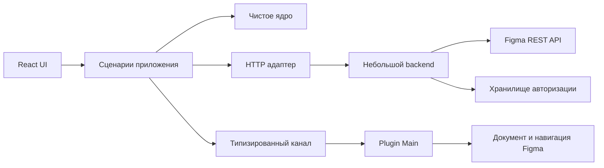

# Архитектура Common Structurizer — предложение v1

> **Архив прежнего проекта Common Structurizer.** Не является действующим решением Personal Notes & Tasks; актуальные документы: [private-notes-architecture.md](private-notes-architecture.md) и [private-notes-implementation-plan.md](private-notes-implementation-plan.md).

Дата: 11 ноября 2026 года. Этап 2. **Статус: на согласовании.**

Документ описывает рекомендуемое решение; реализация и установка новых зависимостей не выполняются на этом этапе. Подтверждённые пользователем решения находятся в product-decisions.md.

## 1. Продукт и границы пилота

Common Structurizer помогает найти обсуждения конкретного экрана и продолжить работу в нативной ветке Figma. Figma хранит комментарии и их статусы; наш плагин читает их и организует навигацию.

Пилот проходит внутри одной команды Figma. Рекомендованный первый поддерживаемый сценарий — Figma Design с правом редактирования, в браузере и Desktop. Dev Mode остаётся отдельной последующей проверкой до включения разработчиков с соответствующими seats; пользователям View не обещается запуск обычного плагина.

В пилот входят: OAuth, явное подключение файла, ветки с ответами, группировка, поиск, фильтры Open/Resolved/All, счётчики, объяснимые непривязанные обсуждения, ручное обновление и открытие нативной ветки. Ручное перемещение обсуждений, запись комментариев, изменение статусов, AI-классификация, web companion, уведомления и командная синхронизация не входят в этот объём.

## 2. Рекомендуемая структура

Один репозиторий, две сборки плагина и один небольшой сервер. Папки ниже — целевая структура; существующий scaffold пока не переносится.

```text
src/
  domain/                  ветки, расположение, поиск, счётчики
  application/             сценарии загрузки, обновления и переходов
  adapters/
    http/                  клиент нашего API
    bridge/                обмен сообщениями с Plugin Main
  plugin/                  реальные вызовы Figma и локальные настройки
  ui/
    app/                   сборка зависимостей и владелец состояния
    features/
      connection/          аккаунт и подключение файла
      navigator/           поиск, фильтры, группы и карточки
      thread/              просмотр ответов и действия обсуждения
    components/            небольшие общие элементы интерфейса
shared/
  contracts/               версии сообщений, DTO и проверки входных данных
server/
  auth/                    OAuth, собственные сессии
  figma/                   клиент REST API и краткий кеш
  storage/                 постоянное хранение авторизации
  http/                    маршруты и сборка сервера
tests/
  domain/ application/ ui/ contracts/ api/ e2e/ fixtures/
experiments/                изолированные технические проверки
```



### Границы ответственности

| Часть       | Делает                                                           | Не получает ответственности за                  |
| ----------- | ---------------------------------------------------------------- | ----------------------------------------------- |
| Domain      | Собирает ветки, определяет группы по фактам, считает и фильтрует | React, HTTP, глобальный figma, хранение токенов |
| Application | Координирует сценарии и состояние операции                       | Обход конкретных Figma-объектов и рисование UI  |
| Plugin Main | Читает узлы и родителей, выполняет переходы, хранит настройки    | OAuth-токены Figma и правила группировки        |
| React UI    | Отображает результат и передаёт намерение пользователя           | Самостоятельные REST-запросы из каждой карточки |
| Backend     | Авторизация, запросы Figma, проверка и нормализация ответа       | Раскладка UI и повторная сборка веток           |

Объекты Figma не пересылаются в UI: только сериализуемые факты. Правило определения экрана находится в одном месте — domain. Сервер возвращает сообщения; ветки собирает только domain, чтобы не появилось двух конкурирующих реализаций.

## 3. Модули и основные сценарии

| Модуль/сценарий      | Вход и результат                                                                               |
| -------------------- | ---------------------------------------------------------------------------------------------- |
| BuildThreads         | Сообщения → корневые обсуждения, ответы, неполные ветки                                        |
| LocateThread         | Привязка корня + факты о родителях → страница, секции, экран/блок или причина неопределённости |
| BuildNavigator       | Обсуждения и расположение → группы, индексы и счётчики                                         |
| SelectVisibleThreads | Снимок, поиск и фильтры → представление без новых сетевых запросов                             |
| ConnectSource        | Ссылка + подтверждение пользователя → контекст подключения                                     |
| RefreshComments      | Запрос комментариев → новый снимок или объяснимая ошибка                                       |
| RefreshLocations     | Повторное чтение нужных узлов → обновлённая группировка без запроса комментариев               |
| OpenNativeThread     | Подтверждённый адрес/проверяемая цель → запрос перехода в Figma                                |
| FocusScreen          | Найденный локальный экран → переключение страницы и фокус на холсте                            |

OpenNativeThread и FocusScreen независимы. Невозможность найти экран локально сама по себе не должна уничтожать возможность открыть обсуждение в исходном файле. Готовность конкретного вида ссылки проверяется отдельно.

## 4. Подключение файла: честная граница

Для Community-совместимой схемы пользователь вставляет ссылку на текущий файл и подтверждает источник. Приватное OAuth-приложение команды не предоставляет обычному плагину доступ к приватному figma.fileKey.

Рекомендация: пока не получать структуру документа через REST. Читаем её локально через Plugin API, уменьшая объём передаваемых серверу данных. Для исходного файла берём метаданные, показываем имя и аккаунт подключения.

Это осознанный компромисс: без fileKey открытого документа нельзя гарантированно доказать, что вставленная ссылка указывает именно на него. Имена, ID узлов и сходная структура дают диагностические признаки, но не криптографическое подтверждение; копия файла может сохранить сходную структуру. Не называем такое подключение автоматически проверенным.

- На каждом новом запуске требуется явное подтверждение источника. Последняя ссылка предлагается как удобный вариант, но не подключается молча.
- Внутри запуска появляется собственный bindingId. Это ID сессии подключения, а не идентификатор Figma-файла.
- При очевидном несоответствии источника и документа локальная группировка не выдаётся за корректную: предлагается исправить ссылку. Совпадение только общего ID страницы недостаточно.
- Пока подключение не подтверждено, поиск по уже полученным сообщениям и переход по исходной ссылке можно отделить от локального сопоставления.
- Данные по файлу A никогда не показываются как актуальные данные файла B при смене подключения.

Если для продукта потребуется строгая автоматическая гарантия соответствия, придётся отдельно выбрать чтение структуры того же исходного файла через REST. Это потребует дополнительных прав, запросов и другого баланса приватности/производительности. Такая гарантия сейчас не обещается.

## 5. Правило группировки v1

Проверена реальная цепочка примера: страница → Desktop design → Orders (Light theme) → Main Content → H1 → Main Actions → Buttons. Предложенное правило относит вложенный элемент к Orders, а не к Main Actions.

1. Положение ветки определяется по корневому комментарию; расположение ответов его не меняет.
2. Для найденной привязки берём путь от страницы к узлу. Секции сохраняются в порядке вложенности.
3. После ближайшей содержащей секции, либо после страницы при отсутствии секции, выбираем первый внешний FRAME. Прозрачные обёртки GROUP не становятся самостоятельными экранами.
4. Если раньше такого FRAME встречается самостоятельный COMPONENT или INSTANCE, используем его как отдельный блок с соответствующим типом. Вложенный контейнер внутри самостоятельного экземпляра не объявляется отдельным экраном.
5. Если подходящего контейнера нет, но страница/секция известна, обсуждение попадает в «Вне экранов» этого контекста.
6. Координаты без надёжной страницы не используются для угадывания экрана. Обсуждение остаётся в общем разделе «Без привязки».
7. Пока чтение узла не завершено, его состояние — «Определяем расположение». Ошибка или отсутствие узла не равны доказанному удалению.

Ключи групп строятся из fileKey и ID элементов, не из названий. Переименование меняет подпись, но не создаёт дубликат группы. Ручные переопределения и несколько переключаемых алгоритмов пока не добавляются.

## 6. Ветки, поиск и счётчики

- ID хранятся строками; большие ID не преобразуются в JavaScript number.
- Одинаковое сообщение не учитывается дважды. Конфликтующие записи с одним ID считаются проблемой данных, а не двумя сообщениями.
- Ответы собираются независимо от порядка в ответе API. Внутри ветки — время создания и стабильный ID как дополнительный порядок.
- Статус берётся из корня. Ответ без найденного корня сохраняется как неполная ветка с неизвестным статусом, а не автоматически Open.
- Поиск включает текст корня, ответы и названия контекста. Совпадение внутри ответа показывает всю ветку и пометку, где найдено совпадение.
- По умолчанию выбран Open. Поиск не меняет этот фильтр молча; пользователь видит активные ограничения.
- Общие числа и количество по текущему фильтру подписываются отдельно. Ответы не увеличивают число открытых обсуждений.
- Каждая полноценная ветка находится ровно в одной группе, включая непривязанные. Неполные ветки показываются отдельным числом.

## 7. Загрузка и состояние

Один владелец состояния приложения: reducer и узкие React contexts/props. На старте не добавляем Redux, Zustand или библиотеку серверного состояния. Производные группы и статистика вычисляются из одного снимка и не хранятся как независимые копии.

Состояние разделено на подключение/авторизацию, снимок комментариев, факты расположения и пользовательское представление. Изменение поиска не инициирует RefreshComments. Повторное определение расположения не перечитывает REST-комментарии.

Каждая операция имеет requestId, bindingId и поколение данных. Ответ от старого подключения отбрасывается. Повторные нажатия Refresh объединяются в одну активную операцию; автоматический бесконечный polling не используется.

Уникальные node ID разрешаются ограниченной очередью, с кешем родительских цепочек на поколение. Все страницы и все слои документа заранее не обходятся. Ошибки отдельных привязок не скрывают остальные ветки.

Снимок имеет fetchedAt, сведения о полноте и причину устаревания. REST-комментарии и живой документ не считаются транзакционно согласованными: после изменения слоя расположение может потребовать повторного чтения.

Ссылки на ветви файлов разбираются отдельно: ключ ветви не подменяется ключом родительского файла. Источник снимка, ключи кеша и нативные ссылки должны относиться к одной и той же ветви.

При временной сетевой ошибке сохраняем последний результат с заметным статусом. При смене аккаунта, выходе или подтверждённой утрате доступа данные старого пользователя скрываются и очищаются из рабочих кешей.

## 8. Контракты границ

Рекомендуется Zod для проверки недоверенных данных на входе. Схемы и версии находятся в shared/contracts; установка — после согласования.

### UI ↔ Plugin Main

Конверт: protocolVersion, requestId, bindingId, type, payload. Ответ содержит тот же контекст и либо result, либо типизированную ошибку.

| Сообщение                          | Смысл                                                         |
| ---------------------------------- | ------------------------------------------------------------- |
| GET_HOST_CONTEXT                   | Редактор, текущая страница, доступные возможности             |
| RESOLVE_ANCHORS                    | Набор ID → пути родителей и исходы found/not-found/error      |
| FOCUS_SCREEN                       | Переключить страницу и показать разрешённый локальный элемент |
| OPEN_NATIVE_THREAD                 | Проверить цель и передать разрешённую ссылку в openExternal   |
| GET_PREFERENCES / SAVE_PREFERENCES | Небольшие версионированные настройки                          |
| HOST_CONTEXT_CHANGED               | Смена текущей страницы или устаревание нужных фактов          |

На стороне Main URL проверяется повторно; принимаются только разрешённые действия. Не создаём универсальный канал выполнения произвольного кода. Обработчик сообщений и подписки устанавливаются один раз и снимаются при завершении.

### UI ↔ Backend

Версия DTO: 1. Набор комментариев содержит fileKey, fetchedAt, признак кеша и плоский массив нормализованных messages. Сообщение сохраняет строковые ID, parentId, текст, автора, даты и вариант anchor. Backend не возвращает уже сгруппированное дерево.

| Маршрут нашего сервиса            | Назначение                                                                                 |
| --------------------------------- | ------------------------------------------------------------------------------------------ |
| POST /v1/auth/flows               | Создать временный OAuth-процесс                                                            |
| GET /v1/auth/figma/callback       | Принять и обработать callback Figma                                                        |
| POST /v1/auth/flows/:flowId/claim | Проверить завершение и один раз получить собственную сессию по отдельному секрету процесса |
| GET /v1/session                   | Проверить собственную сессию и показать подключённый аккаунт                               |
| DELETE /v1/session                | Отозвать собственную сессию                                                                |
| GET /v1/files/:fileKey/meta       | Показать источник                                                                          |
| GET /v1/files/:fileKey/comments   | Получить сообщения; явное fresh=1 требует обновления с учётом лимитов                      |

Это предлагаемые контракты нашего сервиса, а не готовые методы Figma.

## 9. Сервер и авторизация

Рекомендуется Node.js 24 + TypeScript + Fastify, один процесс для пилота. Выбор связан с небольшим числом маршрутов, прозрачными зависимостями и встроенным тестированием запросов через inject, а не с неподтверждёнными обещаниями скорости.

Для одной команды подходит опубликованное приватное OAuth-приложение Figma. Draft-статус не равен готовности к тестированию всей командой. Публичное OAuth-приложение для внешних пользователей потребует отдельного процесса согласования Figma.

Используем Authorization Code + PKCE S256 и state. Обмен кода выполняется сразу в серверном callback, не после ожидания, пока плагин опросит статус. Client secret и Figma access/refresh tokens остаются на сервере. Обновление токена координируется для пользователя: параллельные запросы не должны одновременно заменять его авторизацию.

flowId не даёт права забрать сессию. Для получения результата нужен отдельный секрет, короткий срок действия и одноразовое атомарное получение. Секреты не помещаются в URL и журналы. Пользователь видит аккаунт OAuth; авторизация внешнего окна Figma может отличаться.

Рекомендуемые scopes: file_comments:read, file_metadata:read и current_user:read для понятного отображения подключённого аккаунта. Запись комментариев и чтение всего дизайн-документа через REST в этот объём не включаются.

### Хранение пилота

- SQLite на постоянном диске единственного серверного процесса: гранты OAuth, хеши собственных сессий и временные OAuth-процессы.
- Токены Figma шифруются; ключ хранится вне базы. Собственные bearer-сессии хранятся на сервере в виде хешей, имеют ограниченный срок и отзываются при выходе.
- В plugin clientStorage — настройки и при сохранении входа собственная ограниченная сессия приложения. Это не защищённое хранилище секретов Figma. Refresh token туда не попадает.
- Комментарии на сервере — только короткий кеш в памяти, разделённый по OAuth-пользователю, fileKey и версии прав. В UI — память текущего запуска.
- Тексты сообщений и токены не попадают в диагностику. Выход очищает клиентское состояние; завершение нашей сессии не выдаётся за отзыв доступа в самой Figma.

Схема рассчитана на один процесс с постоянным томом. Stateless/serverless-размещение или несколько реплик потребуют другого постоянного хранилища, например PostgreSQL. Провайдер и платное размещение сейчас не выбираются; их нельзя подключать молча.

## 10. Ошибки и лимиты

В контракте различаются: нужна авторизация, нет подтверждённого доступа, файл недоступен, неверный источник, лимит запросов, временная сеть, неполные данные, неподдерживаемая цель и недоступная возможность редактора.

Upstream 403 сам по себе не превращаем в точный диагноз «файл удалён». Учитываем состояние авторизации и предлагаем соответствующее восстановление. Повтор авторизации/refresh не должен создавать бесконечный цикл.

Для 429 учитываем Retry-After и показываем время доступного повтора. Локальные поиск и фильтры продолжают работать. При ручном обновлении не выдаём старый серверный кеш за свежий ответ Figma.

Текст комментариев выводится как текст. HTML из комментария не исполняется. Markdown, вложения и сложное форматирование не добавляются до отдельного сценария и проверки безопасного отображения.

Для оценки отзывчивости пилота предлагается синтетический набор из 1000 обсуждений с 5000 сообщений и сотнями привязок. Это проектный профиль испытания, а не уже измеренная производительность. Необходимость виртуализации списка или worker определяется измерениями; тяжёлые библиотеки заранее не подключаются.

## 11. Нативный переход: обязательные условия перед пилотом

Технический стенд доказал открытие скопированного URL, но он завершался после вызова. Ещё требуется проверить переход при открытом рабочем UI: сохраняется ли окно плагина, не перекрывает ли ветку и можно ли вернуться к результатам поиска.

Перед вызовом сохраняется небольшой checkpoint: источник, фильтры, поиск, раскрытые группы и выбранная ветка. Тексты комментариев в checkpoint не копируются. Если клиент останавливает плагин, состояние представления восстанавливается при следующем запуске после подтверждения источника.

Генератор URL из REST-данных остаётся отдельным адаптером с версионированными правилами. До допуска в пилот проверяются соответствие ID и открытие ветки: обычная, Resolved, без node ID, ссылка на ответ и недоступная привязка. Имитация или успешное открытие URL не заменяют это испытание.

## 12. Решения, требующие утверждения

1. Один рабочий интерфейс со сгруппированными обсуждениями и раскрытием ответов на месте.
2. Локальная структура документа, явное подтверждение источника и правило группировки v1.
3. Небольшой Fastify-сервер с приватным OAuth команды и постоянным хранилищем авторизации.
4. Предлагаемый тестовый набор и порядок реализации из testing-plan.md и implementation-plan.md.

## Источники и доказательства

- [Figma OAuth](https://developers.figma.com/docs/rest-api/oauth-apps/).
- [Plugin API: fileKey и доступные действия](https://developers.figma.com/docs/plugins/api/figma/).
- [Варианты привязки комментария](https://developers.figma.com/docs/rest-api/comments-property-types/).
- [Лимиты API](https://developers.figma.com/docs/rest-api/rate-limits/).
- [Тестирование Fastify](https://fastify.dev/docs/latest/Guides/Testing/).
- Наблюдения текущего файла: только чтение путей родителей; изменения не выполнялись.
- Базовая проверка реального перехода: experiments/01-native-comment-navigation.md.
