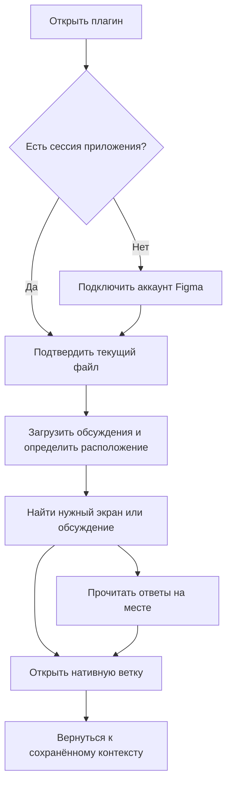

# Интерфейс Common Structurizer — сценарии для согласования

> **Архив прежнего проекта Common Structurizer.** Не является действующим решением Personal Notes & Tasks; актуальные документы: [private-notes-architecture.md](private-notes-architecture.md) и [private-notes-implementation-plan.md](private-notes-implementation-plan.md).

Этап 2. Статус: **предложение**, не утверждённый визуальный дизайн.

## Основное решение

Рекомендую одно рабочее окно со сгруппированным списком обсуждений. Пользователь сразу видит экраны и открытые замечания; ответы раскрываются на месте. Отдельный экран просмотра ветки не обязателен для основной операции.

Нативная ветка открывается отдельным явно подписанным действием. Раскрытие группы или ответов не должно неожиданно уводить пользователя в другой клиент Figma. Первичное подключение занимает ту же рабочую область. Дополнительные модальные окна для штатных действий не предлагаются.

Это выбор устройства сценария, а не обязательство по размерам, цветам и деталям оформления. До реализации нужно проверить поведение компактного окна и длинного содержимого. Возможности Dev Mode потребуют отдельной адаптации размещения.

## Как решение закрывает боли

| Боль                                          | Решение и проверяемое поведение                                                                                 |
| --------------------------------------------- | --------------------------------------------------------------------------------------------------------------- |
| Нужное обсуждение приходится искать на холсте | Поиск по корням, ответам и контексту; результат сразу показывает страницу, секцию и экран                       |
| Непонятно, где осталась работа                | Open выбран по умолчанию; счётчики считают ветки, а не сообщения                                                |
| Нужно быстро продолжить разговор              | Действие «Открыть в Figma» из карточки, без обязательного промежуточного экрана                                 |
| После перехода теряется место в списке        | Сохраняются поиск, фильтры, раскрытые группы, выбранная ветка и по возможности позиция списка                   |
| Ответ спрятан в длинной переписке             | Ответы раскрываются внутри карточки; поиск помечает совпадение в ответе                                         |
| Неясно, почему комментарий не попал к экрану  | Подпись причины вместо общего необъяснимого Unassigned                                                          |
| При обновлении кажется, что всё исчезло       | Старый снимок остаётся при временной сетевой ошибке; видны время обновления и статус                            |
| Открыт не тот аккаунт Figma                   | Видны аккаунт подключения и источник; подсказка учитывает, что внешний клиент может использовать другой аккаунт |

## Главная последовательность

Первое подключение включает вход и вставку ссылки. Повторное использует сохранённую сессию приложения и предлагает последний источник для явного подтверждения. Автоматическое использование предыдущего fileKey в любом новом документе не предлагается.

## Состав React-компонентов

Названия рабочие. Создание каждого элемента отдельным большим модулем не требуется; границы следуют ответственности.

| Компонент                  | Ответственность                                                              |
| -------------------------- | ---------------------------------------------------------------------------- |
| AppShell                   | Рабочая область, размеры и общие состояния; не группирует комментарии        |
| ConnectionGate             | Переключает подключение аккаунта, подтверждение источника и рабочий сценарий |
| AccountConnection          | Начало OAuth, ожидание, отмена, повтор авторизации                           |
| SourceConnection           | Ссылка, имя источника, подтверждение и исправление несоответствия            |
| WorkspaceHeader            | Источник, аккаунт подключения, обновление и время снимка                     |
| NavigatorControls          | Поиск, Open/Resolved/All и область «Весь файл / Текущая страница»            |
| ThreadGroups               | Представляет подготовленные группы; сохраняет их раскрытие                   |
| LocationGroup              | Заголовок контекста и понятные счётчики                                      |
| ThreadCard                 | Автор, начало текста, статус, число ответов и явное нативное действие        |
| ThreadReplies              | Сообщения ветки внутри карточки; не выполняет самостоятельных запросов       |
| UnlocatedThreads           | Ветки без определённого экрана с конкретной причиной                         |
| DatasetStatus              | Устаревание, неполнота, лимит запросов и восстановление                      |
| EmptyState / BlockingError | Разные исходы отсутствия результата и невозможности работы                   |

Состояние операций находится в application и владельце состояния, а не дублируется внутри каждой карточки. В компонент не передаются десятки флагов вида isLogin/isError/isLoading: используются явные состояния и композиция.

## Поведение списка

- В обычном режиме показываются только группы с обсуждениями текущего фильтра. Пустые экраны не сканируются ради нулевых счётчиков.
- Весь файл — исходная область просмотра. Фильтр текущей страницы использует факты Plugin Main, без нового запроса комментариев.
- Ветки с неизвестной страницей остаются отдельным явно подписанным разделом и при фильтре текущей страницы: они не объявляются принадлежащими ей и не пропадают без объяснения.
- Секции могут быть вложенными; путь сохраняется в данных. В компактном представлении длинный путь можно показывать строкой контекста, не превращая его в много пустых уровней раскрытия.
- В группе ветки по умолчанию упорядочены по последней известной активности из загруженных сообщений; одинаковое время разрешается стабильным ID. Ответ повышает активность ветки, но не число обсуждений.
- Сворачивание группы и раскрытие ответов — отдельные действия. Клик по названию ветки не должен неявно менять фильтры или область.
- «Показать экран» — вторичное действие. Оно не подменяет основное «Открыть в Figma».
- В режиме поиска виден контекст найденного сообщения. Не подходящие статусу ветки не включаются молча; фильтр явно виден и может быть сброшен.
- Полные тексты и названия доступны при переполнении; фиксированная высота не должна обрезать единственную полезную информацию.

## Состояния и восстановление

| Состояние                        | Что видит пользователь                                            | Что может сделать                                                  |
| -------------------------------- | ----------------------------------------------------------------- | ------------------------------------------------------------------ |
| Нет сессии                       | Подключение аккаунта                                              | Начать или отменить вход                                           |
| Источник не подтверждён          | Предложенный файл и ссылка                                        | Подтвердить или заменить                                           |
| Первая загрузка                  | Прогресс получения и определения расположения                     | Дождаться или отменить подключение                                 |
| Частично определено расположение | Уже доступные ветки и число оставшихся                            | Читать результат; без ложного сообщения об удалённых слоях         |
| Нет комментариев                 | Подтверждённый пустой источник                                    | Обновить или сменить источник                                      |
| Ничего не найдено                | Активные поиск и фильтры                                          | Очистить ограничения                                               |
| Временная ошибка обновления      | Сохранённый снимок с временем и предупреждением                   | Продолжить локальный поиск или повторить                           |
| Нужен повторный вход             | Прежний пользовательский контекст без раскрытия защищённых данных | Переподключить аккаунт                                             |
| Ограничение частоты запросов     | Время допустимого повтора                                         | Использовать загруженный снимок                                    |
| Ветка не привязана               | Причина и доступные действия                                      | Прочитать её, попробовать подтверждённый способ нативного перехода |
| Источник/аккаунт изменился       | Новое подключение                                                 | Подтвердить источник; чужой снимок не остаётся в списке            |

## Возврат после нативного перехода

На этапе интеграции проверяем переход с открытым рабочим UI. Стенд этапа 1 завершался, поэтому сохранение рабочего окна пока не доказано.

Предпочтение: окно остаётся доступным и не перекрывает нативную ветку. Если клиент Figma требует прекращения/скрытия плагина, используем checkpoint и восстановление при возвращении. Эта ветка решения определяется испытанием, а не догадкой по поведению тестового стенда.

## Проверки удобства

1. Найти все Open-обсуждения экрана в реальном файле и сравнить время с ручным поиском в Figma.
2. Найти фразу, которая встречается только в ответе.
3. Открыть нативную ветку и вернуться к тому же результату поиска.
4. Понять различие между пустым файлом, пустым поиском и ошибкой доступа.
5. Выполнить основной сценарий с клавиатуры и в светлой/тёмной теме Figma.

Визуальный стиль, окончательные размеры, иконки и конкретные формулировки утверждаются на этапе интерфейса. Содержание комментариев не используется как аналитические события.
